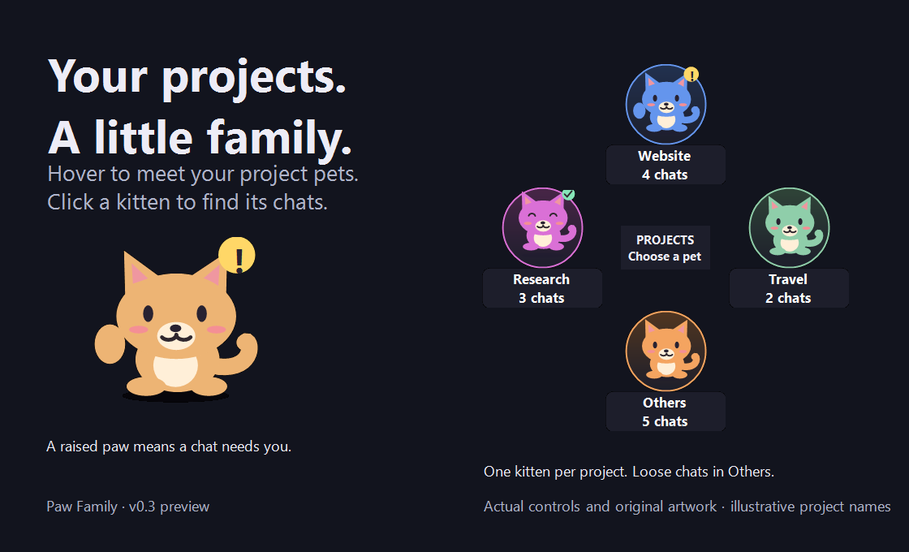

# Paw Family

A free Windows desktop pet that keeps your local Codex projects together.



**[Download the Windows preview](https://github.com/Tus-GitHub/paw-family/releases/tag/v0.3.0)** · [Instructions](README.txt) · [MIT license](LICENSE)

## Get started

1. Download `PawFamily-0.3.0-win-x64.zip` from the release page.
2. Extract it into a folder you want to keep, then run `PawFamily.exe`.
3. Hover over the cat for your projects. Click a kitten for its chats, or click the parent for all chats.

The Windows x64 download includes .NET. You do not need an API key, account for Paw Family, or a separate runtime. The preview is portable and unsigned; it does not install a service or add itself to Windows startup.

## Your project family

- One kitten per registered project, with loose chats together under **Others**.
- Transparent desktop background and a circular menu that pops out on hover.
- Choose each project's color, or switch the parent between cat and dog.
- Walking and resting, a raised paw for recorded permission/question requests, and a happy bounce for completion.
- Searchable chat list with single-click links into the running Codex desktop installation.
- Import your own transparent GIFs for idle, working, attention, completion and optional walking states.

Drag the parent to move it. Right-click the parent for settings and **Exit Paw Family**. Right-click a kitten for its color. Press **Esc** to hide the chat list.

## Preview limitations

This is an independent community project, not an OpenAI product. It supports local Codex session files, including Codex desktop builds branded ChatGPT. Ordinary ChatGPT web/mobile conversations and cloud-only chats are not supported.

Paw Family can only detect events present in local files. Some approvals and connector prompts are not exposed, so alerts are **not a complete inventory of pending requests**. A recorded asynchronous question remains highlighted until a subsequent user message or an aborted task. Local file formats can change between app versions.

Project grouping and reopening a chat in the existing desktop window were confirmed on the development setup. Window reuse still depends on the installed Codex version. Paw Family never answers questions, approves actions, or kills/restarts Codex to navigate.

## Privacy and artwork

The app reads local chat titles, session events and project metadata. It has no telemetry, advertising, server or network client, and it does not modify Codex files. Preferences and imported animations stay in `%LOCALAPPDATA%\PawFamily`.

Source, original procedural cat/dog artwork and the original icon use the MIT license. No AgentPaw or Salary Cat assets are distributed. Import only animation packs you have permission to use. Microsoft's bundled runtime retains its own notices in [THIRD-PARTY-NOTICES.txt](THIRD-PARTY-NOTICES.txt).

## Build

On Windows with the .NET 10 SDK installed:

```powershell
powershell -NoProfile -File .\build.ps1
```

This publishes a self-contained Windows x64 EXE, runs the parser/grouping/movement checks, and creates a ZIP and SHA-256 checksum in `dist/`. The first build downloads official .NET runtime packages.

GitHub Actions builds pull requests and pushes to `main`. A `v*` tag builds the same package and publishes a preview release after the checks pass.

See [README.txt](README.txt) for animation formats, development commands, local data, and removal instructions.
